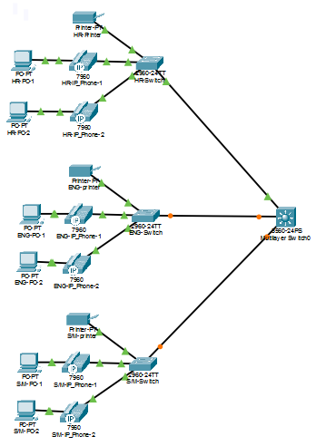
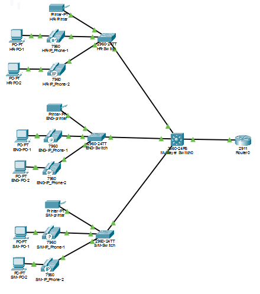
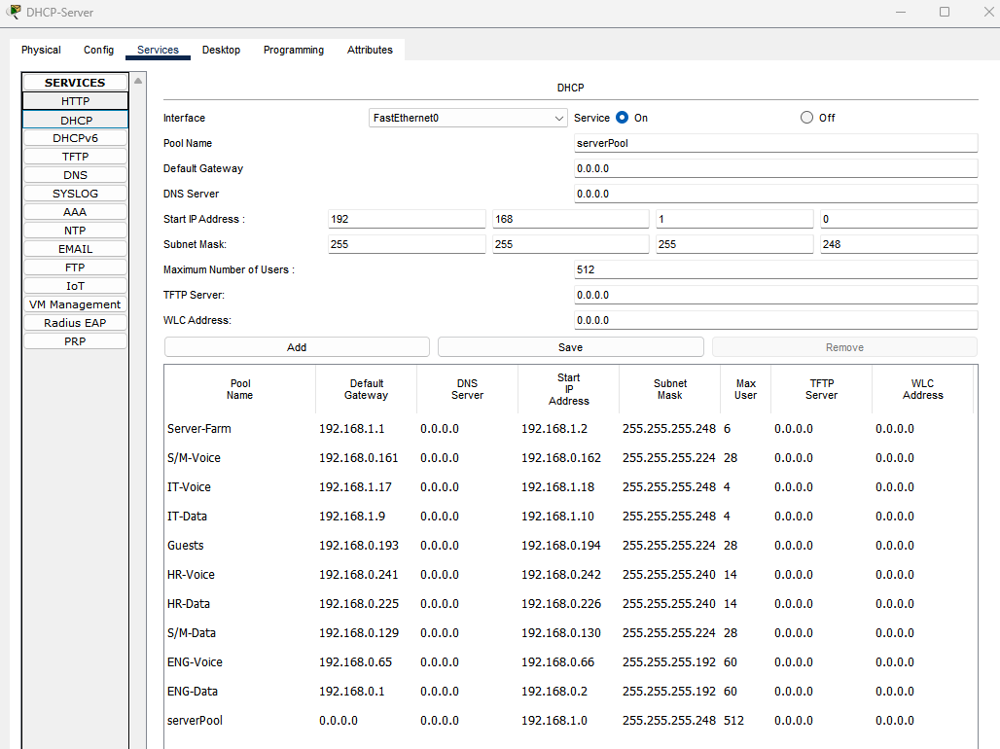
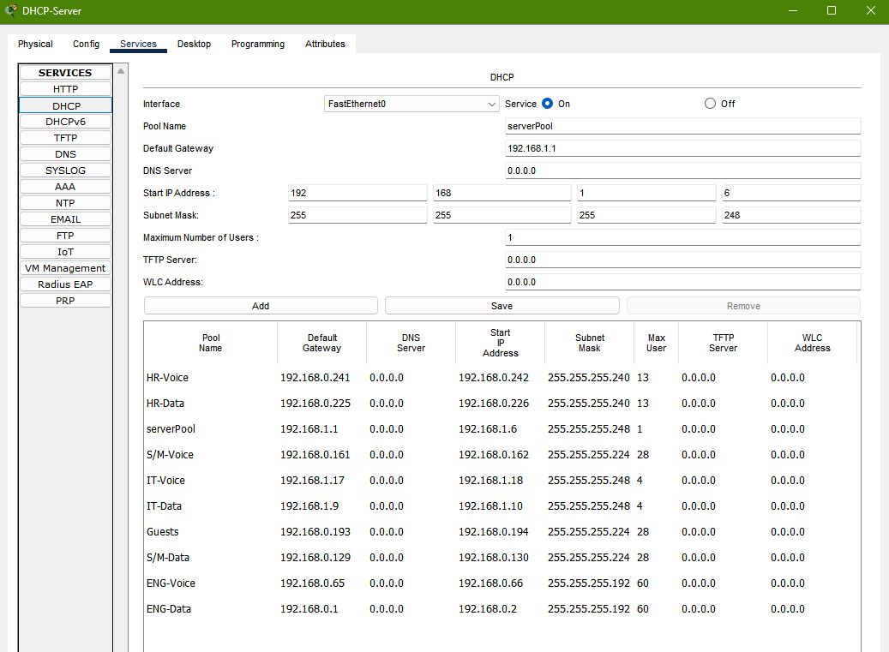
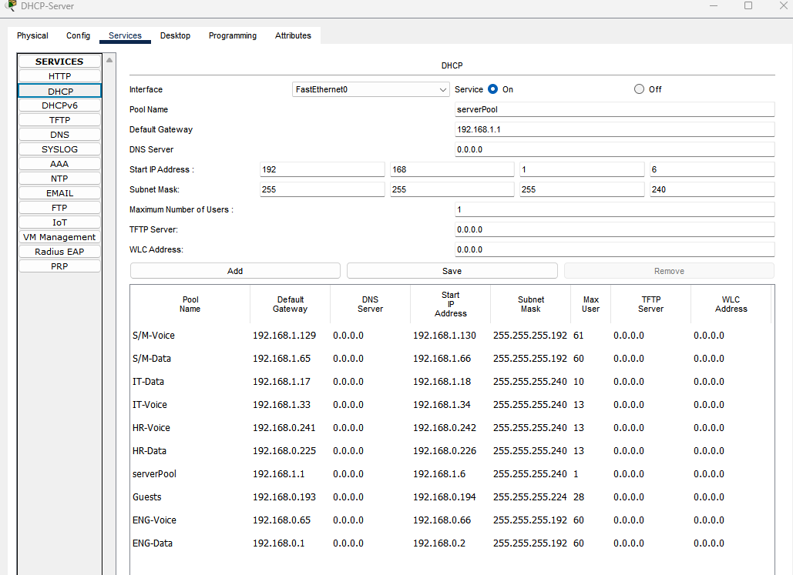

# Problem Solving

[Back to README](readme.md) · [Build steps](HowTo.md)

These are the problems and checks from the Packet Tracer lab. Each record separates what was observed from what was only possible. The old addresses below are part of the history; use [HowTo.md](HowTo.md) for the final setup.

## 1. Clients could not get DHCP addresses

**Problem:** Clients showed APIPA addresses, 169.254.x.x, or kept waiting for DHCP.

**Approach:** Check the device being configured, access VLANs, server connection, core SVI addresses, and relay path.

| Finding | Action |
| :--- | :--- |
| Layer 3 commands were entered on an access switch | Move routing and relay configuration to the 3560 core |
| Old HR/Guest gateways used network addresses .0.224 and .0.192 | Use valid host addresses .0.225 and .0.193 in the original plan |
| The old direct DHCP-server port was in VLAN 10 | Change it to Server VLAN 50 |
| Server/IT SVIs were unassigned | Add the gateway addresses and enable the interfaces |

**Result:** The early lab record reported successful DHCP relay and client leases. The server later moved from Core Gi0/2 to Server-Switch Fa0/1. The addresses were revised in the next stage.

### Early build references



*Early department links. The image shows the build in progress, not final link status.*



*The router was physically connected before the later routing and service configuration.*

## 2. The original subnets had too little room

**Problem:** Server Farm and IT Data had /29 networks. After the gateway, only five device addresses remained, below their six-device targets. Other subnets needed more room for the new growth target.

**First approach:** Expand DHCP masks and pool sizes, then update core SVIs.

**Further checks:** Compare the full subnet ranges before applying changes. Review static IPs, server masks, Guest ACL addresses, and client leases.

**Action:** Plan for 50% more devices plus the gateway. Move the overlapping networks instead of only changing masks.

| Step | Change |
| :--- | :--- |
| 1 | Move IT Data and Voice |
| 2 | Expand Server Farm after IT leaves its old range |
| 3 | Move S/M Data and Voice |
| 4 | Move Guest and update the ACL |
| 5 | Move HR Data into the old Guest area |
| 6 | Expand HR Voice after the old HR Data range is free |

**Result:** Sample clients received the new settings and reached their expected targets. This was a capacity calculation and sample-device test, not a full-pool exhaustion test.

HR Voice already had enough room for eight phones plus 50% growth under /28. Its /27 expansion was an extra choice, not a proven shortage.

### Old and new address comparison

| Network | VLAN | Old subnet | Old gateway | New subnet | New gateway | New mask | New usable range |
| :--- | ---: | :--- | :--- | :--- | :--- | :--- | :--- |
| ENG-Data | 20 | 192.168.0.0/26 | 192.168.0.1 | 192.168.0.0/26 | 192.168.0.1 | 255.255.255.192 | 192.168.0.1–62 |
| ENG-Voice | 120 | 192.168.0.64/26 | 192.168.0.65 | 192.168.0.64/26 | 192.168.0.65 | 255.255.255.192 | 192.168.0.65–126 |
| S/M-Data | 30 | 192.168.0.128/27 | 192.168.0.129 | 192.168.1.64/26 | 192.168.1.65 | 255.255.255.192 | 192.168.1.65–126 |
| S/M-Voice | 130 | 192.168.0.160/27 | 192.168.0.161 | 192.168.1.128/26 | 192.168.1.129 | 255.255.255.192 | 192.168.1.129–190 |
| Guests | 99 | 192.168.0.192/27 | 192.168.0.193 | 192.168.1.192/26 | 192.168.1.193 | 255.255.255.192 | 192.168.1.193–254 |
| HR-Data | 10 | 192.168.0.224/28 | 192.168.0.225 | 192.168.0.192/27 | 192.168.0.193 | 255.255.255.224 | 192.168.0.193–222 |
| HR-Voice | 110 | 192.168.0.240/28 | 192.168.0.241 | 192.168.0.224/27 | 192.168.0.225 | 255.255.255.224 | 192.168.0.225–254 |
| Server Farm | 50 | 192.168.1.0/29 | 192.168.1.1 | 192.168.1.0/28 | 192.168.1.1 | 255.255.255.240 | 192.168.1.1–14 |
| IT-Data | 40 | 192.168.1.8/29 | 192.168.1.9 | 192.168.1.16/28 | 192.168.1.17 | 255.255.255.240 | 192.168.1.17–30 |
| IT-Voice | 140 | 192.168.1.16/29 | 192.168.1.17 | 192.168.1.32/28 | 192.168.1.33 | 255.255.255.240 | 192.168.1.33–46 |
| Staff Wi-Fi | 60 | Not built | — | 192.168.2.0/25 | 192.168.2.1 | 255.255.255.128 | 192.168.2.1–126 |

### DHCP screenshots from the change



*Early values included an oversized default pool and HR lease counts that needed correction.*



*The default pool was limited, but the old Server/IT subnets and growth plan still needed work.*



*Despite the file name, this is a partial fix: S/M and IT are moved, but HR and Guest still show old addresses. Use HowTo.md for the final settings.*

## 3. The core rejected a new S/M address

**Problem:** The switch rejected 192.168.0.65/26.

```text
Switch(config-if)#no ip address
Switch(config-if)#ip address 192.168.0.65 255.255.255.192
% 192.168.0.64 overlaps with Vlan120
```

**Approach:** Compare network-to-broadcast ranges, not just gateway or DHCP start addresses.

**Finding:** ENG Voice already used 192.168.0.64/26. Another proposed pair, .0.129 and .0.162, would also overlap under /26. Both belong to .0.128–191. The following /26 was occupied by Guest and HR at the time.

**Action:** Use S/M Data 192.168.1.64/26 and Voice 192.168.1.128/26. Explicitly set both SVI addresses.

**Result:** S/M PC received 192.168.1.67/26, gateway 192.168.1.65, and reached the gateway and servers.

**Important detail:** Removing the old address succeeded even when the next address command failed. The correct SVI address had to be restored.

## 4. A Guest client still showed the old address

**Problem:** Guest first showed 192.168.0.195/27 with gateway .0.193 after the migration steps.

**Approach:** Confirm the saved DHCP pool and SVI, then renew the client rather than assuming the new pool failed.

**Action:** Select Static, then DHCP in the client IP Configuration.

**Result:** The client showed 192.168.1.195/26 with gateway .1.193. The wireless Guest later received .1.196.

## 5. The ENG printer was inside the DHCP range

**Problem:** The original printer address .0.4 was inside the DHCP range .0.2–61. A duplicate allocation was possible; an actual duplicate lease was not captured.

**Approach:** Compare static addresses against pool start and maximum users.

**Action:** Set ENG-Data to 58 users, giving .2–59, and move the printer to 192.168.0.62/26 with gateway .0.1.

**Result:** Printer Ping passed 3/3 and DHCP-server Ping passed 2/2. The final saved pool-limit screen was not captured, so successful Ping is not used to prove that field.

The default serverPool was also kept at a single lease, 192.168.1.6. That address was excluded from static server assignments.

## 6. Guest DHCP worked, but server Ping failed

**Observed behavior:** Guest reached its gateway but received Destination host unreachable for 192.168.1.2 and .3.

**Approach:** Check the policy and ACL counters instead of treating every failed Ping as an outage.

**Finding:** The seven wired test requests matched seven hits on the internal-network deny rule. DHCP had a separate permit.

**Result:** This was expected Guest isolation. Wireless Guest checks later showed the same gateway-success/server-block behavior.

A hit on the final Guest permit rule did not prove PAT or external service access; those were tested separately.

## 7. SSH reached Password prompts, then closed

**Problem:** Core and IT switch connections reached authentication but did not accept the login.

**Approach:** Keep this separate from a connection blocked before authentication. Check the local account on the target device and its VTY login setting.

**Action:** Reset the netadmin secret on the target device and apply login local to its VTY lines.

**Result:** IT-Switch later accepted the login. Core login also passed after its separate ACL problem was corrected. The exact original password/input error was not confirmed.

Each switch had its own local account; the core account did not automatically exist on the access switch.

## 8. Core SSH was refused because of the ACL

**Problem:** Later Core connection attempts returned Connection refused before a Password prompt.

**Approach:** Check show ip ssh, VTY settings, show users, and ACL counters.

**Finding:** SSH v2 was enabled, but the ACL allowed the wrong subnet:

```text
Standard IP access list SSH-IT-ONLY
 10 permit 192.168.1.0 0.0.0.15
 20 deny any (10 match(es))
```

**Action:**

```text
configure terminal
ip access-list standard SSH-IT-ONLY
 no permit 192.168.1.0 0.0.0.15
 no deny any
 permit 192.168.1.16 0.0.0.15
 deny any
exit
end
```

**Result:** IT login reached Core-Switch#. Non-IT access was blocked. The collected counters were permit 2/deny 5 on Core, 16/16 on IT, and 2/15 on HR.

A separate activation message mentioned SSH 1.99. The follow-up show ip ssh output confirmed version 2.0; the log text alone was not used as the version check.

## 9. IP-based HTTP worked, but the hostname failed

**Problem:** Ping to the DNS server and HTTP by IP worked, but the name returned Hostname unresolved.

**Approach:** Check the client DNS address, DNS service state, and the actual A record.

**Finding:** The DNS address was correct, but DNS Service was Off.

**Action:** Turn DNS On and retest the name. Apply the internal DNS address to all staff Data pools and external DNS to Guest.

**Result:** Internal-name access across departments and Guest external-name access were tested successfully by the lab owner. Individual nslookup outputs were not all saved.

## 10. The edge router did not accept telephony-service

**Problem:** The current 2911 simulation returned Unrecognized command.

**Approach:** Check command support before changing the working edge network.

**Action:** Add a separate 2811 and run telephony-service ?. It returned <cr>. Keep routing/PAT on the edge and configure CME on the 2811.

**Result:** The voice feature became available. This was a model/IOS finding in Packet Tracer, not a claim that all real 2911 routers lack voice support.

## 11. Phones stayed at Configuring CM List

**Problem:** The phone did not register, and show ephone was empty.

**Approach:** Check the Voice DHCP TFTP field, the voice-router interface address, and CME registration settings.

**Findings:**

- Voice-Router used 192.168.1.3, already assigned to Web-Server.
- CME had no ip source-address.

**Action:** Change the router to 192.168.1.4/28, set ip source-address 192.168.1.4 port 2000, run create cnf-files, confirm Voice-pool TFTP .4, and restart a phone.

**Result:** The supplied output confirmed HR phone .0.226, MAC 0060.3E43.7B36, registered with extension 1001. The lab owner directly tested all eight registrations and calls between HR/ENG and S/M/IT.

## 12. Syslog severity commands failed

**Problem:** logging trap informational and logging trap 6 were rejected.

**Approach:** Use logging ? to check the supported command options. Do not assume the entire trap function is missing.

**Action:** Apply logging trap debugging and inspect show logging.

**Result:** Core showed logging enabled to 192.168.1.2 on UDP 514 at debugging level. The server received two CONFIG_I events and one LOGGINGHOST_STARTSTOP from 192.168.1.1.

The server screenshot was supplied during the lab but is not currently a file in resources. Device timestamps were not synchronized with the real date.

## 13. Initial Ping timeouts and invalid test targets

**Observation:** S/M→Web and the later restore check each showed an initial timeout followed by replies.

**Approach:** Record the actual counts. Initial ARP was possible, but not confirmed as the cause.

**Result:** S/M→Web returned 2/3 and the restore check returned 2/3. No clean four-reply repeat was supplied.

Guest also pinged 192.168.1.192, the /26 network address. A reply from .193 was not evidence of an endpoint at .192. Typing errors such as ing and show running config were corrected separately.

## 14. Checking whether the backup could restore a setting

**Test:** Deliberately change the IT switch hostname and load its saved file from TFTP.

**Approach:** Save a backup first. Apply one visible temporary change. Restore into running-config, then check the hostname, management SVI, ACL, and access.

### Recorded restore result

The supplied CLI output confirms a successful TFTP backup and a restore into the running configuration.

| Check | Actual result | Status |
| :--- | :--- | :--- |
| Save startup-config | Building configuration... [OK] | Output checked |
| Upload IT-Switch-final.cfg to 192.168.1.2 | [OK - 1979 bytes] | Output checked |
| Change hostname | IT-Switch → RESTORE-TEST | Output checked |
| Read the backup into running-config | [OK - 1979 bytes] | Output checked |
| Restore hostname | Prompt returned to IT-Switch# | Output checked |
| Management SVI | VLAN 40, 192.168.1.28, up/up | Output checked |
| SSH ACL | Permit 192.168.1.16 0.0.0.15, then deny any | Output checked |
| Client Ping to 192.168.1.28 | 2/3 replies; first request timed out | Replies checked |
| Client SSH to 192.168.1.28 | Login reached IT-Switch# | Output checked |

Backup output:

```text
IT-Switch#copy running-config tftp:
Address or name of remote host []? 192.168.1.2
Destination filename [IT-Switch-confg]? IT-Switch-final.cfg
Writing running-config...!!
[OK - 1979 bytes]
1979 bytes copied in 0 secs
```

Restore output:

```text
IT-Switch(config)#hostname RESTORE-TEST
RESTORE-TEST(config)#end
RESTORE-TEST#copy tftp: running-config
Address or name of remote host []? 192.168.1.2
Source filename []? IT-Switch-final.cfg
Destination filename [running-config]?

Accessing tftp://192.168.1.2/IT-Switch-final.cfg...
Loading IT-Switch-final.cfg from 192.168.1.2: !
[OK - 1979 bytes]
1979 bytes copied in 0 secs
IT-Switch#
```

The restored VLAN 40 interface was 192.168.1.28 and up/up. The ACL output still showed permit and deny entries, with 16 matches each. Those counters confirm the entries were present; they do not prove a new denied login was tested after the restore.

This test used **copy tftp: running-config**, which merges the file into the active configuration. The hostname changed back, proving that the downloaded file applied a saved value. The IP and ACL checks show the expected configuration was present afterward; those settings were not deliberately removed before the test.

This was not an erased-device rebuild, a full configuration replacement, or a reboot recovery test. The first Ping timeout is recorded as observed; its cause was not confirmed. Successful retrieval also proves this backup file was present and readable on the server, even without a file-list screenshot.


## Recorded test results

These are the supplied Ping counts, including tests stopped with Ctrl+C. Short internal addresses below use the 192.168 prefix.

| Source | Setting or target | Actual result | Status |
| :--- | :--- | :--- | :--- |
| IT PC | .1.19/28, GW .1.17, DHCP .1.2 | ipconfig | Output checked |
| IT PC | Gateway .1.17 / server .1.2 / printer .1.30 | 2/2, 2/2, 4/4 | Passed |
| Web server | .1.3/28, GW .1.1 | ipconfig | Output checked |
| Web server | IT PC .1.19 | 2/2 | Passed |
| S/M PC | .1.67/26, GW .1.65, DHCP .1.2 | ipconfig | Output checked |
| S/M PC | Gateway .1.65 / server .1.2 | 2/2, 3/3 | Passed |
| S/M PC | Web .1.3 | 2/3, first request timed out | Replies checked; clean repeat pending |
| Guest wired | .1.195/26, GW .1.193 | ipconfig | Output checked |
| Guest wired | Gateway .1.193 | 2/2 | Passed |
| Guest wired | Server .1.2 / Web .1.3 | 0/4, 0/3; unreachable | Expected block |
| HR PC | .0.195/27, GW .0.193 | ipconfig | Output checked |
| HR PC | Gateway / DHCP / Web / printer .0.221 | 2/2, 3/3, 2/2, 2/2 | Passed |
| ENG PC | Printer .0.62 / server .1.2 | 3/3, 2/2 | Passed |
| Guest wireless | .1.196/26, GW .1.193 | Wireless0 ipconfig | Output checked |
| Guest wireless | Gateway | 2/2, 23–35 ms | Passed |
| Guest wireless | Server .1.2 / Web .1.3 | 0/2 each; unreachable | Expected block |
| Staff wireless | .2.11 | Wireless0 IP | Output checked |
| Staff wireless | Gateway .2.1 / server .1.2 / external .113.10 | 2/2 each | Passed |

Staff Wireless0 output ended after its IP; the full wireless mask/gateway/DNS fields were not captured.

### Additional results

| Area | Result | Record |
| :--- | :--- | :--- |
| Core–Edge | Transit and two internal static routes; Edge→Core 4/5 Ping | CLI output |
| PAT | IT .1.19 and Staff .2.11 share 203.0.113.1 for external HTTP | CLI output |
| DNS | Staff internal names and Guest external names worked | Direct lab tests confirmed by owner |
| Phones | Eight registrations, HR–ENG and S/M–IT calls | Direct lab tests confirmed by owner; one HR registration capture |
| SSH | Core/IT/HR login and allowed/blocked ACL hits | CLI output |
| Staff Wi-Fi | Internal/external Ping worked; internal name worked; management SSH blocked | Ping output and owner confirmation |
| Syslog | Three core messages received on the server | Server screenshot supplied in chat |
| Backups | Backup task completed | Owner confirmation; IT transfer output |
| Restore | IT hostname restored and management access checked | CLI output |

### Actual PAT output

```text
Pro Inside global      Inside local        Outside local      Outside global
tcp 203.0.113.1:1027   192.168.2.11:1027   203.0.113.10:80    203.0.113.10:80
tcp 203.0.113.1:1031   192.168.1.19:1031   203.0.113.10:80    203.0.113.10:80

Total translations: 2 (0 static, 2 dynamic, 2 extended)
Outside Interfaces: GigabitEthernet0/1
Inside Interfaces: GigabitEthernet0/0
Hits: 20  Misses: 8
Expired translations: 6
```

The misses counter is not a count of failed connections or lost packets.

## Evidence limits

The lab owner completed the phone and backup tests. Missing full phone/file-list captures are kept separate from tests known to have failed.

The record does not claim an erased-device restore, reboot recovery, synchronized device clocks, or a full monitoring dashboard. Some final settings, including the ENG pool-limit screen, remain uncaptured.

The saved files are [the final network](fake-company-final.pkt) and [the restore test](fake-company-restore-test.pkt). The documentation update did not independently rerun them.

[Earlier detailed records in Git history](https://github.com/junuiui/network-infrastructure-lab/tree/69d8c1a8993dfd07d1f167922214b5a84aa0ceb9/docs)

[Back to README](readme.md) · [Build steps](HowTo.md)
