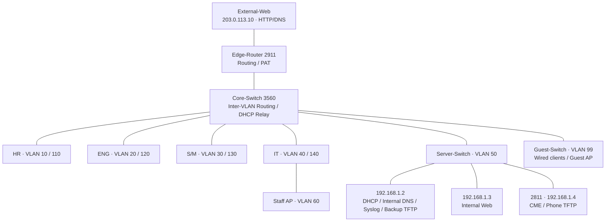

# Architecture & Topology

[← 메인 README](../readme.md) · [재구축 가이드](guide.md) · [검증 결과](validation.md)

> 기준: 2026-10-27. 설정 절차와 실제 검증 상태를 구분한다.

## 프로젝트 목적

Cisco Packet Tracer에서 기업 부서망을 구성하고 설정 이유, 장애 진단, 복구 및 검증을 기록한다. 목표 인원은 70명이며 실제 배치는 대표 단말로 검증한다.

## 회사 규모와 설계 목표
| Department | # People | # Machines | Core Devices & Details |
| :--- | :--- | :--- | :--- |
| **HR/Finance** | 8 | 18 | 8 PCs, 8 IP Phones, 2 Network Printers |
| **Engineering** | 35 | 72 | 35 PCs/Laptops, 35 IP Phones, 2 Test Workstations |
| **Sales/Marketing** | 22 | 45 | 22 Laptops/PCs, 22 IP Phones, 1 Network Printer |
| **IT Support/Admin** | 5 | 11 | 5 Management PCs, 5 IP Phones, 1 Admin Terminal |
| **Server Farm** | - | 6 | Active Directory/DNS, DHCP, Web, FTP, Database, Syslog |
| **Guests** | - | approx. 20 | Temporary Wireless Devices (Smartphones, Laptops) |
| **Total** | **70** | **172** | - |

---

위 표의 수량/합계는 초기 회사 시나리오이다. Guest는 대략적인 수량이며, 실제 구현 장비 수를 나타내지 않는다. 초기 Server 목표 중 AD/Database는 실제 구현 범위가 아니다.

## 전체 구조

## 연결 포트

| Core 포트 | 반대 장비 / 포트 | 최종 역할 |
| :--- | :--- | :--- |
| Fa0/1 | HR-Switch Gi0/1 | VLAN 10,110 Trunk |
| Fa0/2 | ENG-Switch Gi0/1 | VLAN 20,120 Trunk |
| Fa0/3 | S/M-Switch Gi0/1 | VLAN 30,130 Trunk |
| Fa0/4 | IT-Switch Gi0/1 | VLAN 40,60,140 Trunk |
| Fa0/5 | Server-Switch Gi0/1 | VLAN 50 Trunk |
| Fa0/6 | Guest-Switch Gi0/1 | VLAN 99 Trunk |
| Gi0/1 | Edge-Router Gi0/0 | Routed link 10.0.0.1/30 ↔ 10.0.0.2/30 |
| Gi0/2 | 미사용 | 초기 DHCP 직접 연결 이력만 존재 |

Core Fa0/1~3의 실제 수집 출력은 auto 협상으로 trunking이었으며 모든 VLAN을 허용했다. 위 표는 각 부서의 필요한 VLAN이다. 재구축 가이드에서는 명시적 Trunk와 필요한 VLAN 목록을 사용한다.

| Access 장비 | 포트 | 연결 |
| :--- | :--- | :--- |
| HR/ENG/S/M/IT | Fa0/1~2 | IP Phone의 Switch 포트, Phone PC 포트에는 PC |
| HR/ENG/S/M/IT | Fa0/3 | Printer (부서별 Data VLAN) |
| IT-Switch | Fa0/4 | Staff-AP Port 0 / VLAN 60 |
| Server-Switch | Fa0/1 | DHCP-Server |
| Server-Switch | Fa0/2 | Web-Server |
| Server-Switch | Fa0/3 | Voice-Router Fa0/0 |
| Guest-Switch | Fa0/1~2 | 유선 Guest 단말용 |
| Guest-Switch | Fa0/3 | Guest-AP Port 0 |
| Edge-Router | Gi0/1 | External-Web FastEthernet0 |

사진에는 Guest Printer도 있으나 주소/통신 테스트는 수집하지 않았다. Guest의 기존 DHCP 전체 범위 안에 임의 고정 IP를 넣지 않는다.

## 실제 구현 경계

- 실제 공용 Internet/Google 연결이 아니라 Router 밖의 모의 외부 서버이다.
- Server-PT는 Windows Server/AD가 아니다.
- 모니터링 범위는 Core 중앙 Syslog 수집이며 성능 대시보드/자동 알림은 없다.
- SSH는 Core/IT/HR에 적용했다. 다른 Access Switch는 반복 실습으로 생략했다.
- 최종 [Packet Tracer 파일](../fake-company-final.pkt)은 저장소에서 존재를 확인했다. 파일을 새로 실행해 전체 설정을 대조한 것은 아니다.

주소는 [Addressing](addressing.md), 따라 만들기는 [Guide](guide.md), 확인 근거는 [Validation](validation.md)을 참고한다.

---

[← 메인 README](../readme.md) · [재구축 가이드](guide.md) · [검증 결과](validation.md)
