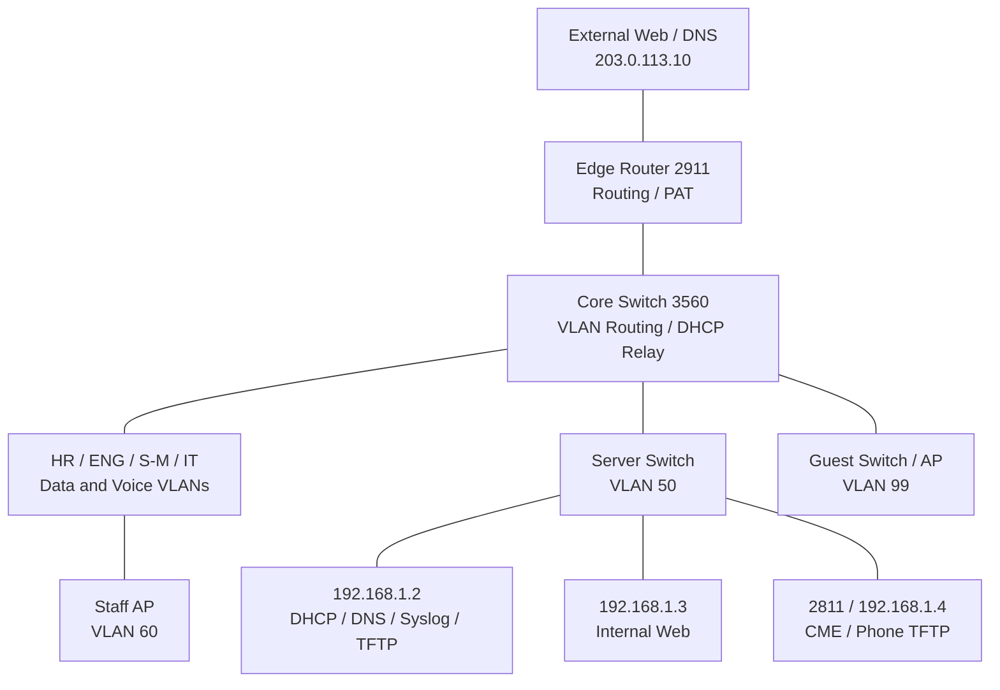

# Architecture and Topology

[Back to main README](../readme.md) · [Rebuild guide](guide.md) · [Test results](validation.md)

## Goal

Build and test a company network in Cisco Packet Tracer. Keep a clear record of what each setting does, why it is needed, and how it was checked.

## Company plan

| Department | People | Planned devices |
| :--- | ---: | :--- |
| HR/Finance | 8 | 8 PCs, 8 IP phones, 2 printers |
| Engineering | 35 | 35 PCs/laptops, 35 IP phones, 2 test workstations |
| Sales/Marketing | 22 | 22 PCs/laptops, 22 IP phones, 1 printer |
| IT | 5 | 5 management PCs, 5 IP phones, 1 admin terminal |
| Server Farm | — | Original plan: 6 servers |
| Guests | — | About 20 wireless clients |

These are design targets. The lab uses sample devices. The original server plan mentioned AD and a database, but those services were not built here.

## Final layout

*Four departments connect to the core. The server area has DHCP/DNS, Web, and CME. Staff and guests use separate APs.*

The Staff AP connects through the IT switch. Its traffic stays in VLAN 60, separate from IT Data VLAN 40.

## Core port map

| Core port | Other end | Final role |
| :--- | :--- | :--- |
| Fa0/1 | HR-Switch Gi0/1 | HR Data 10 / Voice 110 |
| Fa0/2 | ENG-Switch Gi0/1 | ENG Data 20 / Voice 120 |
| Fa0/3 | S/M-Switch Gi0/1 | S/M Data 30 / Voice 130 |
| Fa0/4 | IT-Switch Gi0/1 | IT 40/140 and Staff Wi-Fi 60 |
| Fa0/5 | Server-Switch Gi0/1 | Server VLAN 50 |
| Fa0/6 | Guest-Switch Gi0/1 | Guest VLAN 99 |
| Gi0/1 | Edge-Router Gi0/0 | Routed link: 10.0.0.1/30 to 10.0.0.2/30 |
| Gi0/2 | Unused | Used for the DHCP server in the early setup |

The collected output showed Fa0/1–3 using negotiated trunks with all VLANs allowed. The rebuild guide uses explicit trunks and lists the VLANs each link needs. The other core uplinks already used explicit trunks.

## Access port map

| Switch | Port | Device |
| :--- | :--- | :--- |
| HR / ENG / S/M / IT | Fa0/1–2 | Phone Switch port; PC connects to the phone PC port |
| HR / ENG / S/M / IT | Fa0/3 | Department printer |
| IT | Fa0/4 | Staff-AP Port 0 |
| Server | Fa0/1 | DHCP-Server |
| Server | Fa0/2 | Web-Server |
| Server | Fa0/3 | Voice-Router Fa0/0 |
| Guest | Fa0/1–2 | Wired Guest client ports |
| Guest | Fa0/3 | Guest-AP Port 0 |
| Edge-Router | Gi0/1 | External-Web FastEthernet0 |

The final image also shows a Guest printer. Its IP and print access were not checked in the collected results.

## How the layout grew

*Early HR wiring. A phone and PC share one switch port but use different VLANs.*

*Early three-department layout. This image shows the build in progress, not the final link state.*

*The edge router was added before the later server, Guest, and Staff sections.*

## Lab limits

- The external server is outside the company network in the design. It is not a real Internet connection.
- Server-PT does not provide Windows Server or AD DS.
- SSH is configured on Core, IT, and HR only.
- Monitoring covers core Syslog messages, not SNMP graphs or automatic alerts.
- [fake-company-final.pkt](../fake-company-final.pkt) exists in the repository. Its settings were not rerun during this documentation pass.

Next: [Address plan](addressing.md) or [Rebuild guide](guide.md).

---

[Back to main README](../readme.md) · [Rebuild guide](guide.md) · [Test results](validation.md)
