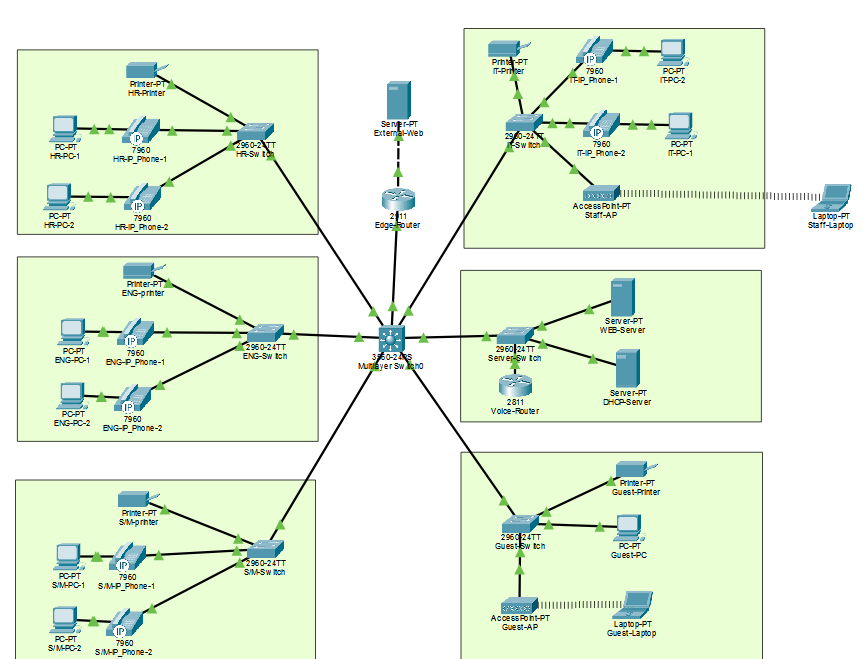

# Tests and Evidence

[Back to main README](../readme.md) · [Rebuild guide](guide.md) · [Test results](validation.md)

## How to read the status

| Label | Meaning |
| :--- | :--- |
| Output checked | CLI text or a screenshot was supplied for that result |
| Owner-tested | The lab owner explicitly confirmed a hands-on test; a full capture may not be saved |
| Reported complete | A successful result was reported without the individual raw result |
| Pending | The specific result was not supplied |

The documentation assistant did not rerun the .pkt. The lab owner later ran the IT-Switch restore and supplied its CLI output. Ping counts below are the actual counts from the supplied output; many tests were stopped with Ctrl+C.

## Address and connectivity tests

| Source | Setting or target | Actual result | Status |
| :--- | :--- | :--- | :--- |
| IT PC | .1.19/28, GW .1.17, DHCP .1.2 | ipconfig | Output checked |
| IT PC | Gateway .1.17 / server .1.2 / printer .1.30 | 2/2, 2/2, 4/4 | Passed |
| Web server | .1.3/28, GW .1.1 | ipconfig | Output checked |
| Web server | IT PC .1.19 | 2/2 | Passed |
| S/M PC | .1.67/26, GW .1.65, DHCP .1.2 | ipconfig | Output checked |
| S/M PC | Gateway .1.65 / server .1.2 | 2/2, 3/3 | Passed |
| S/M PC | Web .1.3 | 2/3, first request timed out | Replies checked; clean repeat pending |
| Guest wired | .1.195/26, GW .1.193 | ipconfig | Output checked |
| Guest wired | Gateway .1.193 | 2/2 | Passed |
| Guest wired | Server .1.2 / Web .1.3 | 0/4, 0/3; unreachable | Expected block |
| HR PC | .0.195/27, GW .0.193 | ipconfig | Output checked |
| HR PC | Gateway / DHCP / Web / printer .0.221 | 2/2, 3/3, 2/2, 2/2 | Passed |
| ENG PC | Printer .0.62 / server .1.2 | 3/3, 2/2 | Passed |
| Guest wireless | .1.196/26, GW .1.193 | Wireless0 ipconfig | Output checked |
| Guest wireless | Gateway | 2/2, 23–35 ms | Passed |
| Guest wireless | Server .1.2 / Web .1.3 | 0/2 each; unreachable | Expected block |
| Staff wireless | .2.11 | Wireless0 IP | Output checked |
| Staff wireless | Gateway .2.1 / server .1.2 / external .113.10 | 2/2 each | Passed |

Short addresses use the 192.168 prefix unless the row names 203.0.113.10. The final Staff ipconfig was cut off after the wireless IP, so its full wireless mask/gateway/DNS fields were not collected.

## Guest ACL

The wired Guest test sent seven requests to internal servers. The ACL showed:
```text
permit udp any eq bootpc any eq bootps (13 match(es))
permit icmp 192.168.1.192 0.0.0.63 host 192.168.1.193 echo (2 match(es))
deny ip any 192.168.0.0 0.0.255.255 (7 match(es))
```

Later output showed DHCP 16, gateway 4, and private-network deny 11. A match count is a packet count, not a number of users or sessions.

## SSH

| Device | Login result | ACL counters | Evidence |
| :--- | :--- | :--- | :--- |
| Core .1.17 | Core-Switch# | Permit 2 / deny 5 | Output checked |
| IT .1.28 | IT-Switch# after account reset | Permit 16 / deny 16 | Output checked |
| HR .0.220 | HR-Switch# | Permit 2 / deny 15 | Output checked |

The core `show ip ssh` confirmed v2. The IT/HR version output and full final configs were not supplied. SSH logins were checked. Telnet blocking was configured but not separately tested.

The PC login text did not include source IPs; the source roles follow the lab's IT/non-IT test steps.

## Routing, DNS, and phones

| Check | Result | Evidence |
| :--- | :--- | :--- |
| Edge to Core | 4/5 Ping | Output checked |
| Edge routes | Transit C/L and .0/24, .1/24 static routes via 10.0.0.1 | Output checked |
| IT to Edge / external connection | Successful | Reported complete |
| Internal DNS across four Data pools | Name-based Web access successful after DNS On | Reported complete |
| Guest external DNS and HTTP | External name works, internal access blocked | Reported complete |
| HR phone | .0.226, MAC 0060.3E43.7B36, extension 1001 REGISTERED | Output checked |
| All phones | Eight registrations and HR–ENG / S/M–IT calls directly tested by the lab owner | Owner-tested; function complete |
| Staff internal DNS and SSH restriction | Web name works; Core SSH denied | Reported complete |

## PAT output

```text
Pro Inside global      Inside local        Outside local      Outside global
tcp 203.0.113.1:1027   192.168.2.11:1027   203.0.113.10:80    203.0.113.10:80
tcp 203.0.113.1:1031   192.168.1.19:1031   203.0.113.10:80    203.0.113.10:80

Total translations: 2 (0 static, 2 dynamic, 2 extended)
Outside Interfaces: GigabitEthernet0/1
Inside Interfaces: GigabitEthernet0/0
Hits: 20  Misses: 8
Expired translations: 6
```

This confirms Staff Wi-Fi and IT wired clients share 203.0.113.1. It is not proof of access to the public Internet.

## Syslog receiver

The core showed logging enabled to .1.2, UDP 514, level debugging. The supplied server screen showed two CONFIG_I messages and one LOGGINGHOST_STARTSTOP message from .1.1.

The device timestamps did not match the real date. Clock synchronization was not checked.

## Backup and saved file

| Item | Status |
| :--- | :--- |
| IT startup-config | [OK] output checked |
| IT TFTP copy | 1,979-byte upload checked |
| Core / Edge / Voice backup task | Owner confirmed complete; individual captures not supplied |
| IT running-config restore | 1,979-byte download, hostname restoration, SVI/ACL and SSH checked |
| [fake-company-final.pkt](../fake-company-final.pkt) | Repository file exists; not independently rerun by the documentation assistant |
| Erased-device / reboot recovery | Not tested; outside this restore test |


## IT-Switch backup and restore test

The supplied CLI output confirms a successful TFTP backup and a restore into the running configuration.

| Check | Actual result | Status |
| :--- | :--- | :--- |
| Save startup-config | Building configuration... [OK] | Output checked |
| Upload IT-Switch-final.cfg to 192.168.1.2 | [OK - 1979 bytes] | Output checked |
| Change hostname | IT-Switch → RESTORE-TEST | Output checked |
| Read the backup into running-config | [OK - 1979 bytes] | Output checked |
| Restore hostname | Prompt returned to IT-Switch# | Output checked |
| Management SVI | VLAN 40, 192.168.1.28, up/up | Output checked |
| SSH ACL | Permit 192.168.1.16 0.0.0.15, then deny any | Output checked |
| Client Ping to 192.168.1.28 | 2/3 replies; first request timed out | Replies checked |
| Client SSH to 192.168.1.28 | Login reached IT-Switch# | Output checked |

Backup output:

```text
IT-Switch#copy running-config tftp:
Address or name of remote host []? 192.168.1.2
Destination filename [IT-Switch-confg]? IT-Switch-final.cfg
Writing running-config...!!
[OK - 1979 bytes]
1979 bytes copied in 0 secs
```

Restore output:

```text
IT-Switch(config)#hostname RESTORE-TEST
RESTORE-TEST(config)#end
RESTORE-TEST#copy tftp: running-config
Address or name of remote host []? 192.168.1.2
Source filename []? IT-Switch-final.cfg
Destination filename [running-config]?

Accessing tftp://192.168.1.2/IT-Switch-final.cfg...
Loading IT-Switch-final.cfg from 192.168.1.2: !
[OK - 1979 bytes]
1979 bytes copied in 0 secs
IT-Switch#
```

The restored VLAN 40 interface was 192.168.1.28 and up/up. The ACL output still showed permit and deny entries, with 16 matches each. Those counters confirm the entries were present; they do not prove a new denied login was tested after the restore.

This test used **copy tftp: running-config**, which merges the file into the active configuration. The hostname changed back, proving that the downloaded file applied a saved value. The IP and ACL checks show the expected configuration was present afterward; those settings were not deliberately removed before the test.

This was not an erased-device rebuild, a full configuration replacement, or a reboot recovery test. The first Ping timeout is recorded as observed; its cause was not confirmed. Successful retrieval also proves this backup file was present and readable on the server, even without a file-list screenshot.

## Screenshot references



*Layout evidence, not proof that every service passed.*

The [screenshot index](../resources/readme.md) labels the older images. The DHCP “fixed” image is an intermediate stage, not the final DNS/TFTP/HR/Guest configuration.

## Remaining checks

- [ ] Confirm ENG-Data Max Users is saved as 58.
- [ ] Capture the DHCP server NIC /28 and any remaining printer/final-config details.
- [x] Close the backup task based on the lab owner's direct confirmation; keep uncaptured file listings distinct from raw evidence.
- [ ] Check saved startup configs and the final .pkt state.
- [x] Close eight-phone registration and call testing based on the lab owner's hands-on confirmation.
- [x] Verify an IT-Switch running-config restore using the supplied CLI output.
- [ ] Optional evidence only: collect full phone and non-IT-switch backup listings if needed.
- [ ] Optional extended test: erased-device or reboot recovery, only if that scope is later claimed.

Unchecked items are missing evidence or test scope, not automatic failure findings.

## Repeat-test checklist

| Area | Action | Expected |
| :--- | :--- | :--- |
| Staff PCs | ipconfig, internal-name HTTP | Correct settings and page opens |
| Guest | Gateway Ping, internal-server Ping | Pass, block |
| IT | SSH Core, IT, HR | Login |
| Non-IT and Staff Wi-Fi | Same SSH targets | Block |
| Staff Wi-Fi | Internal/external HTTP | Pass |
| Edge | Routes, NAT table, statistics after traffic | Return paths and translations |
| Voice | show ephone, call another department | Registration and connected call |
| Syslog | Create config event, check server | New message received |
| Backup | Copy config, check TFTP list | Transfer and file confirmed |

---

[Back to main README](../readme.md) · [Rebuild guide](guide.md) · [Test results](validation.md)
