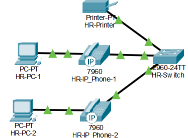
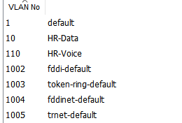

# IP Phones and Call Manager Express

[Back to main README](../readme.md) · [Rebuild guide](guide.md) · [Test results](validation.md)

## What was built

Four departments already had two 7960 phones each, for eight phones total. Each PC connects through the phone's PC port. The switch port carries separate Data and Voice VLANs.



*The physical link is shared. Data and Voice VLANs separate the traffic.*



*The HR switch VLAN list. Creating a Voice VLAN alone does not register phones or enable calls.*

## Why a separate router?

The edge 2911 returned `% Unrecognized command` for `telephony-service ?` in this Packet Tracer setup. A new 2811 returned `<cr>`, so it was used for voice.

This was a model/IOS limit in the simulator. It does not mean all real 2911 routers lack voice support. The edge routing and PAT setup stayed on the existing router.

| Setting | Value |
| :--- | :--- |
| Device | Voice-Router, Cisco 2811 |
| Link | Fa0/0 to Server-Switch Fa0/3 |
| Server VLAN | 50 |
| Address | 192.168.1.4/28 |
| Default next hop | 192.168.1.1 |
| Extensions | 1001–1008, assigned by registration order |

Server-Switch Fa0/3 is an access port in VLAN 50. See the [guide](guide.md) for the full switch setup.

## CME configuration

```text
enable
configure terminal
hostname Voice-Router
interface fastEthernet0/0
 description TO-SERVER-SWITCH
 ip address 192.168.1.4 255.255.255.240
 no shutdown
exit
ip route 0.0.0.0 0.0.0.0 192.168.1.1

telephony-service
 max-ephones 8
 max-dn 8
 ip source-address 192.168.1.4 port 2000
 auto assign 1 to 8
exit
ephone-dn 1
 number 1001
exit
ephone-dn 2
 number 1002
exit
ephone-dn 3
 number 1003
exit
ephone-dn 4
 number 1004
exit
ephone-dn 5
 number 1005
exit
ephone-dn 6
 number 1006
exit
ephone-dn 7
 number 1007
exit
ephone-dn 8
 number 1008
exit
telephony-service
 create cnf-files
exit
end
```

| Setting | Purpose |
| :--- | :--- |
| telephony-service | Enter CME setup |
| max-ephones 8 | Allow eight phones |
| max-dn 8 | Allow eight extension entries |
| ip source-address ... port 2000 | Set the address and SCCP port for registration |
| ephone-dn / number | Create an extension entry and number |
| auto assign 1 to 8 | Give entries to registering phones |
| create cnf-files | Build phone configuration files |

CME controls phone registration and calls. SCCP carries phone control messages. TFTP provides phone configuration files.

The automatic numbers are not tied to departments or MAC addresses. Read the number shown on each phone before testing a call.

## DHCP settings for phones

Set **TFTP Server = 192.168.1.4** in all four Voice pools and click Save. This is how the phone learns where to get its configuration, using DHCP Option 150 in this lab workflow.

| Department | Voice VLAN | DHCP range |
| :--- | ---: | :--- |
| HR | 110 | 192.168.0.226–254 |
| Engineering | 120 | 192.168.0.66–125 |
| Sales/Marketing | 130 | 192.168.1.130–190 |
| IT | 140 | 192.168.1.34–46 |

The phone TFTP server is Voice-Router .4. It is not the backup TFTP service on DHCP-Server .2.

## Registration problem and fix

The phone stayed at **Configuring CM List**. `show ephone` was empty.

The supplied config showed two problems:

1. Fa0/0 used **192.168.1.3**, already used by the Web server.
2. CME had no **ip source-address**.

The fix was to set Fa0/0 to .4, add `ip source-address 192.168.1.4 port 2000`, rebuild the config files, check the four DHCP TFTP fields, and restart a sample phone.

Actual registration output:
```text
ephone-1 Mac:0060.3E43.7B36
REGISTERED in SCCP ver 12 and Server in ver 8
IP:192.168.0.226
button 1: dn 1 number 1001 CH1 IDLE
```

REGISTERED confirms registration. IDLE means the phone is waiting for a call; it does not prove a call completed.

## Call tests

1. Restart the remaining phones and wait for numbers.
2. Run `show ephone` and check eight registrations and the right Voice subnets.
3. Call the ENG phone from HR using its displayed number.
4. Pick up on ENG and confirm the connected state, then hang up.
5. Repeat between S/M and IT.

All eight registrations and both department-pair call tests were reported complete. Only the sample HR registration output was collected. See [Validation](validation.md).

---

[Back to main README](../readme.md) · [Rebuild guide](guide.md) · [Test results](validation.md)
