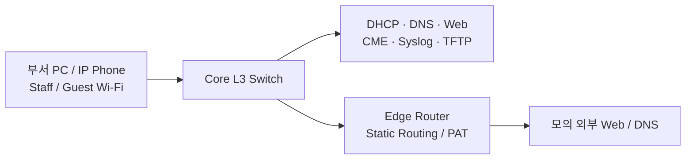

# Enterprise Network Infrastructure Lab

**Cisco Packet Tracer · 기업 네트워크 설계·구축·문제 해결**

HR, Engineering, Sales/Marketing, IT와 Guest를 분리하고, 대표 단말로 IP 할당부터 무선·전화·외부 서비스 접속까지 검증한 학습 프로젝트입니다.

[**재구축 가이드 시작하기 →**](docs/guide.md) · [**최종 Packet Tracer 파일**](fake-company-final.pkt) · [**검증 결과**](docs/validation.md) · [**문제 해결 기록**](docs/troubleshooting.md)

---

## Project at a Glance

| 항목 | 요약 |
| :--- | :--- |
| 플랫폼 | Cisco Packet Tracer |
| 구조 | Core L3 + 부서별 Access + Edge + 별도 Voice Router |
| 구역 | 4개 부서의 Data/Voice, Server, Guest, Staff Wi-Fi |
| 주요 서비스 | 중앙 DHCP/Relay, 내부·외부 DNS, HTTP, CME |
| 접근 제어 | Guest 내부 차단, IT 전용 SSH |
| 운영 실습 | 중앙 Syslog 수신, 수동 TFTP 설정 백업 |
| 학습 방식 | 설정 목적 이해 → 구현 → 장애 진단 → 결과 기록 |

## 01 · Architecture & Addressing

부서별 VLAN으로 역할을 분리하고, 주소 용량과 50% 성장 여유를 검토해 Subnet을 재설계했습니다. 기존 주소와 변경 후 주소를 함께 보존했습니다.

**[장비·연결·구성도 →](docs/architecture.md)** · **[변경 전/후 IP·DHCP 표 →](docs/addressing.md)**

## 02 · Routing, DHCP & DNS

Core가 VLAN Gateway와 DHCP Relay를 담당하고 Edge가 외부 경로와 PAT를 담당합니다. 직원은 내부 DNS, Guest는 모의 외부 DNS로 이름을 조회합니다.

직원 무선 192.168.2.11과 IT PC 192.168.1.19가 외부 주소 203.0.113.1을 공유하는 PAT 변환표를 수집했습니다.

**[설정 목적·명령·서비스 흐름 →](docs/network-services.md)**

## 03 · Security & Remote Management

Guest의 내부망 접근을 ACL로 차단하고, Core·IT·HR 장비의 SSH를 IT 유선 대역에만 허용했습니다. 나머지 Access Switch의 SSH 반복 적용은 실습 범위에서 생략했습니다.

**[Guest ACL·SSH 계정·VTY 접근 정책 →](docs/security.md)**

## 04 · Guest & Staff Wireless

두 AP/SSID를 별도 VLAN에 연결했습니다. Guest는 내부 접근 차단, Staff는 내부 업무 서비스 사용이 가능하며 두 무선망 모두 장비 관리 SSH는 제한합니다.

**[AP·SSID·VLAN·연결 및 테스트 →](docs/wireless.md)**

## 05 · IP Telephony

별도 2811 CME에 4개 부서의 전화기 8대를 등록하도록 구성했습니다. HR 전화의 실제 등록 출력을 수집했고, 전체 등록 및 부서 간 통화 성공을 보고받았습니다.

**[CME·Voice DHCP·내선번호·통화 검증 →](docs/voip.md)**

## 06 · Logs & Configuration Backup

Core 이벤트가 중앙 Syslog 서버에 수신되는 화면을 확인했습니다. IT-Switch의 내부 설정 저장 출력을 수집했고 TFTP 백업 완료를 보고받았습니다. 다른 대표 장비의 개별 백업 결과는 확인 대기로 구분합니다.

**[Syslog 수집·지원 명령 오류·TFTP 백업 →](docs/monitoring-backup.md)**

## 07 · Troubleshooting & Validation

Subnet overlap, DHCP/고정 IP 중복 위험, SSH 인증/ACL 오류, DNS Service Off, 전화 Router IP 중복과 CME 설정 누락을 진단하고 수정했습니다.

**[증상 → 원인 → 해결 → 검증 기록 →](docs/troubleshooting.md)**  
**[실제 출력·완료 보고·확인 대기 항목 →](docs/validation.md)**

## Build It Again

빈 파일에서 같은 최종 설계를 만드는 순서입니다. 장비 배치, 포트 연결, 장비별 CLI, GUI 값, 명령의 목적과 단계별 확인 방법을 포함합니다.

**[guide.md — 처음부터 따라 만들기 →](docs/guide.md)**

## Scope & Evidence

- **직접 확인:** 대표 단말 IP/Ping, Guest ACL, SSH 로그인/카운터, Core–Edge 경로, HR 전화 등록, 직원 Wi-Fi Ping, PAT 변환표, 서버 Syslog 수신.
- **완료 보고:** 일부 DNS/HTTP, 전체 8대 전화 등록·통화, 직원 Wi-Fi SSH 차단, IT-Switch TFTP 백업.
- **확인 대기:** 일부 최종 설정/백업 파일과 복원 테스트. 최종 .pkt의 저장소 존재는 확인했으며 문서 분리 과정에서 재실행하지 않았습니다.

External-Web은 **모의 외부망**이며 실제 Internet/Google 접속이 아닙니다. Server-PT는 Windows Server/AD가 아닙니다. Syslog는 이벤트 수집이며 성능 대시보드·자동 알림은 구현하지 않았습니다. Python 자동화는 제외했습니다.

## Documentation Map

| 문서 | 내용 |
| :--- | :--- |
| [guide.md](docs/guide.md) | 최종 설계 재구축 Step-by-step |
| [architecture.md](docs/architecture.md) | 장비 역할·포트 맵·구성도 |
| [addressing.md](docs/addressing.md) | 기존/신규 IP, DHCP 및 고정 주소 |
| [network-services.md](docs/network-services.md) | Routing·DHCP·PAT·DNS |
| [security.md](docs/security.md) | Guest ACL·SSH |
| [wireless.md](docs/wireless.md) | 직원·Guest Wi-Fi |
| [voip.md](docs/voip.md) | CME·전화 등록·통화 |
| [monitoring-backup.md](docs/monitoring-backup.md) | Syslog·수동 백업 |
| [troubleshooting.md](docs/troubleshooting.md) | 실제 문제와 해결 과정 |
| [validation.md](docs/validation.md) | 검증 결과와 남은 확인 |
| [기존 통합 기록](docs/archive/implementation-log.md) | 문서 분리 전 전체 기록 보존 |

**기록 기준: 2026-10-27.** 상세 문서마다 메인 README로 돌아오는 링크가 있습니다.
