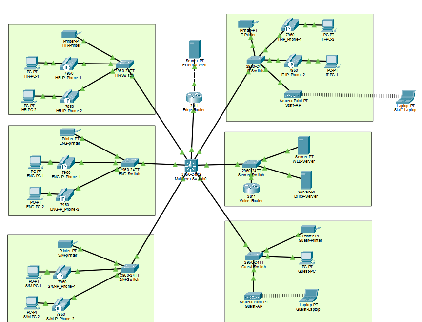

# Company Network Infrastructure Lab

**Cisco Packet Tracer | Networking, troubleshooting, and recovery**

## Summary

I built a simulated company network for a 70-employee plan across HR, Engineering, Sales/Marketing, and IT. I used sample devices to test department networks, shared services, access control, and recovery.

## Motivation

I wanted to practice building network infrastructure and troubleshooting common office connectivity problems. This lab helped me follow traffic from a client through VLANs, routing, and network services, then check whether the setup worked as intended.

## Implementation

| Area | What I built |
| :--- | :--- |
| Switching and routing | Department Data and Voice VLANs, Server and wireless VLANs, inter-VLAN routing on a 3560 core, and static routes |
| Addressing and services | Revised subnets, central DHCP with relay, static printer addresses, DNS, and HTTP |
| External access | Edge-router PAT, with wired IT and Staff Wi-Fi clients sharing one external address |
| Access control | Guest ACLs blocking internal networks; SSH restricted to wired IT clients on Core, IT, and HR switches |
| Wireless and voice | Separate Staff and Guest APs; eight IP phones using Call Manager Express on a 2811 router |
| Logs and recovery | Core Syslog collection and a manual IT-Switch TFTP backup and running-config restore |

The existing lab records include client connectivity checks, Guest blocking, SSH access tests, PAT entries, DNS/web access, phone calls, and Syslog events. The restore returned the IT switch hostname and allowed SSH login.

**Build guide:** [HowTo.md](HowTo.md)

**Lab files:** [Final network](fake-company-final.pkt) · [Restore test](fake-company-restore-test.pkt)

## Problems and Solutions

1. **Overlapping subnets:** The core rejected a proposed S/M address because it overlapped with ENG Voice. I compared full subnet ranges and moved S/M Data and Voice to separate /26 networks. The S/M client then received the new settings and reached its gateway and servers.
2. **SSH blocked for IT:** The Core SSH ACL permitted the Server subnet instead of IT Data. I checked SSH settings and ACL counters, then corrected the permit to `192.168.1.16/28`. IT login worked and non-IT access was blocked.
3. **HTTP worked by IP but failed by name:** I checked the client DNS setting, service state, and A record. DNS Service was Off. After enabling it, name-based access passed in the owner's lab tests.

See [ProblemSolving.md](ProblemSolving.md) for the investigation steps, reasons, fixes, and recorded results for all cases.

## Limitations

- This is a Packet Tracer simulation with sample clients. The 70-employee plan was not a full-device or load test. The external server simulates an outside network; it is not a live Internet connection.
- SSH was configured on Core, IT, and HR only. Syslog covers core event collection, without a full monitoring dashboard or synchronized device clocks.
- The restore merged a backup into running-config. An erased-device rebuild and reboot recovery were not tested.
- This documentation uses existing lab records; the latest `.pkt` files were not independently rerun during this revision. Some results rely on owner confirmation, and some captures remain missing. [Evidence limits](ProblemSolving.md#evidence-limits) lists the details.
